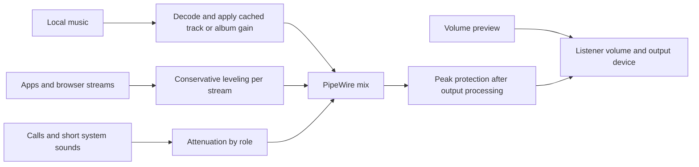

# Balanced playback

Balanced playback uses the volume-change sound as its reference. At a given
volume and on the same output, music, films and other sounds should generally
land below the cue. Normal, very loud and very quiet programme should settle
near a common level. Silence and the noise floor stay quiet.

## What works today

The volume rocker and the output slider in Settings play the same fixed-pitch
bell at the resulting device volume when Sound Effects is enabled. The preview
is pinned to the output that changed. A running preview suppresses overlapping
previews during rapid adjustments. Muted and zero-volume outputs stay silent.
Sound Settings shows the current device and jack where available. The Output
picker switches between connected devices and shows the chosen device's volume.

The built-in music and film players and desktop effects derive their limits from
the rendered bell. The first play of a local file in the built-in players
scans the entire audio track before opening its playback stream. FFmpeg's EBU
R128 scanner measures integrated loudness and true peak. Console caches the
measurements by file revision, then applies one gain from the start of playback.
Later plays and seeks reuse the measurement. An edit invalidates the cache,
and the original audio file is left intact. If analysis fails, live leveling
can handle the decoded audio. [FFmpeg EBU R128 filter](https://ffmpeg.org/ffmpeg-filters.html#ebur128)

With **Automatic Leveling** on, WirePlumber installs an internal PipeWire
filter on compatible PCM playback streams. Indexed files get their fixed gain.
The real-time filter handles streams such as browser and game audio. A 5 ms
look-ahead softens loud onsets. Sustained quiet audio can receive up to 28 dB of
gain above the noise floor. The sample peak limit and the sustained level
target are about 6 dB below the corresponding bell measurements. PipeWire
applies the app's volume after leveling, so the app slider controls its level
relative to the other sounds in the mix. Turning Automatic Leveling off keeps
the original source dynamics and the output's peak protection. [PipeWire processing order](https://github.com/PipeWire/pipewire/blob/1.6.9/spa/plugins/audioconvert/audioconvert.c#L3597-L3615)

Live leveling keeps a three-second moving level in memory for each stream.
A sustained loud passage can reduce the available boost by up to 1.6 dB as
the stream gets quiet. The estimate fades as the stream continues and resets
when the stream is recreated. Pauses have no way to raise the maximum boost.

Sound Settings groups active streams by application. An app's menu can bypass
leveling for that app and can restore the global policy. WirePlumber remembers
the override for apps with an identity. **Reset App Volumes** sets
the playing apps' volume to 100 percent. An individual app's menu can reset it
on its own. These controls preserve mute and the selected output's volume.
WirePlumber saves app levels when it recognizes their identity.

The output filter uses one gain across all advertised channels. It limits
individual samples and uses a faster power detector to hold down short loud
bursts, including after silence and with automatic leveling disabled. Its
sample ceiling sits about 9 dB below the bell's sample peak, allowing extra
headroom for later resampling. WirePlumber rebuilds a lost filter while its
output remains connected. Regular playback stays silent on that output while
the filter is unavailable. The bell and the filtered mix share the device's
volume and mute controls. The desktop manifest and NixOS module install the
policy.

WirePlumber remembers each recognized device and jack route's level. New
routes with no saved level default to 25 percent on the volume slider.
The same bell lets the listener match speakers, headphones, and earphones
by ear and keep the chosen level for each identifiable route. A different
pair of wired earphones in the same jack can look like the same route.
Digital level measurements cannot determine how loud a specific device
sounds at the ear. This policy covers playback linked by WirePlumber.
Applications that open the hardware directly can bypass the filter.

An evaluation fork of [sdroege/ebur128](https://github.com/sdroege/ebur128) lives
in [forks/console-core-audio-loudness](forks/console-core-audio-loudness), pinned in
[UPSTREAM.toml](forks/console-core-audio-loudness/UPSTREAM.toml). The fork
retains the upstream source and license text. Its standalone workspace lets
the crate build independently. The installed policy uses PipeWire's built-in
filters and the existing sound synthesizer for its reference. [PipeWire filter chain](https://docs.pipewire.org/page_module_filter_chain.html)

The library provides momentary, short-term, integrated, loudness-range and
true-peak measurements that could also support a system-wide processor.

## What to build

Use a shared perceived-loudness baseline, with different gain decisions for
files whose complete contents can be scanned and streams whose future is
unknown. A single continuously reacting compressor cannot preserve all the
dynamics of music while also making every quiet passage equally audible.

Measure the rendered preview through the same channel mapping as the
programme. Use its maximum momentary loudness as the upper reference for
sustained playback, with a conservative margin below it. Measure the true
peak of the preview as well and allow headroom for downmixing, resampling and
summation. Keep the cue and programme under the same listener volume control.
The 400-millisecond measurement window follows the European Broadcasting
Union's momentary loudness convention. [Production guidance](https://tech.ebu.ch/docs/tech/tech3343v4_1.pdf)



The installed policy applies indexed track gain or live leveling before the
final mix.
The volume preview joins at the output device with the listener's volume
control. Background library scanning, album gain and role policies in this
graph remain proposals. Encoded audio requires decoding before it can be leveled.

### Local files: background indexing and album gain

1. Decode the full track in the background. Measure integrated gated loudness
   and maximum true peak across the correctly mapped channels. Account for the
   intended playback layout, including mono playback and downmixing.
2. Cache measurements, scanner version and decoding assumptions against a
   content identity. Invalidate the cache when the audio or decoder changes.
   Keep raw measurements so changing the target does not require rescanning.
3. Apply one gain for the entire track, including after seeking. Use track gain
   for shuffle; use a common album gain during album playback to preserve the
   intended differences between movements and songs. Derive album loudness
   from combined gated analysis, not an arithmetic average of LUFS values;
   use the maximum album peak to constrain the shared gain.
4. Leave source samples intact on disk. Store results in the library cache,
   with optional ReplayGain metadata export for other supporting players.
   Re-encoding MP3/AAC/Opus solely to adjust volume adds an avoidable lossy
   generation. A separate normalized export is appropriate when a destination
   player cannot apply metadata, but is not the library default.

For valid measurements, the current file scanner bounds the gain by both
true peak and the maximum boost:

```text
desired_gain_db = target_lufs - measured_integrated_lufs
peak_allowance_db = ceiling_dbtp - measured_true_peak_dbtp
applied_gain_db = min(desired_gain_db, peak_allowance_db, max_boost_db)
sample_multiplier = 10 ** (applied_gain_db / 20)
```

The same multiplier applies to every channel. For a track at the -70 LUFS
measurement floor, the desired gain is zero and peak protection still applies.
Without a valid measurement, the live filter handles playback from the start.

Existing ReplayGain/R128 metadata can avoid scanning, but validate its units,
reference level and peak semantics first. ReplayGain 2.0 gain commonly refers
to -18 LUFS, while Opus R128 gain refers to -23 LUFS and uses Q7.8 dB integers.
Our Opus decoder already applies the header output gain. Measure its resulting
PCM or explicitly account for the header when interpreting tags; never apply
that gain twice. Legacy peak tags may be sample peaks rather than true peaks.

The player decodes in
`crates/console-music-player/src/decoding.rs` and hands float samples to `pw-cat`
in `sounding.rs`. It passes the indexed gain as a property on that stream.
WirePlumber selects the fixed gain or live filter. Tag keys already exist in
`console-core-audio-metadata` and the player uses the tags for display.

### What the existing music-library setup teaches the OS

The supplied `dmusic`/beets setup is evidence about the library our OS must
handle. Its downloading, organization and recovery rules are useful design
inputs; balanced playback should work independently of which downloader or
tagger produced a file. The following is an OS proposal, not a change to that
setup or its import flow.

Reference context supplied by the user: downloads are kept as MP3, beets
maintains tags and final paths in a library database, and pending downloads
retain recoverable staging state. The playable library coexists with own
productions, quarantine and exact-original backups. Many album assignments
remain unresolved, and identical audio was deliberately retained in distinct
album contexts. Loudness processing is disabled. These are reported properties
of an existing local setup, not assumptions that every OS library should
inherit. Its dated cleanup counts are historical; future implementation should
inspect the current catalog rather than use those counts as live state.

**Give the OS a shared media catalog.** Music, Files and playback should agree
on a stable item identity, its current playable path, descriptive metadata,
source provenance and audio-analysis results. An existing library can be
registered in place. Importers are adapters into that catalog, while playback
and loudness measurement are services shared by all sources. Beets metadata
can be reused where available without requiring every OS music item to have
passed through beets. This avoids separate panels building conflicting views
of the same library.

**Distinguish playable collections from storage used for recovery.** In the
example, `active/` is a playable collection, `.incoming/` holds unfinished
work, and quarantine and cleanup backups hold copies that should not appear
as additional songs. `create/` is a separate collection of productions, which
may need processing bypass for reference listening. A recursive walk of all
of `~/music` would cross these boundaries. The current player walks its chosen
root recursively in `library.rs`, so register collection roots and their roles
explicitly rather than assuming that every audio file below a parent folder
belongs in the listening queue. Do not infer these roles from dated folder
names.

**Analyze the actual playable audio, with durable background work.** Every
ready local item can use the same Rust scanner, regardless of whether it was
downloaded, copied from a USB drive or produced locally. Store measurement
state as pending, ready or failed, with a resumable queue and bounded workers.
Use the encoded audio payload or a validated audio revision for invalidation:
retagging and moving a file should not require decoding it again. A modified
audio payload, changed decoder or changed playback-layout assumptions should.
The full-file hash alone would also change when tags or embedded artwork are
edited. Playback can start before background analysis completes; the absence
of a measurement must remain explicit rather than inventing a gain.

**Keep attribution separate from audio facts.** Unknown artists, missing
albums and uploader labels do not prevent track loudness measurement. They
do make inferred album groups unreliable. A `Non-Album` folder or a download
playlist is not sufficient evidence of one musical programme: default those
items to track gain and use shared album gain only for an established album
played in that context. Retain alternate/live/remix distinctions. Loudness
similarity does not establish duplicates, and two intentional album entries
may share audio analysis while retaining distinct metadata and album gains.

**Keep measurements and playback policy distinct.** Existing organization and
tags do not imply normalized playback; the supplied setup explicitly leaves
loudness processing disabled. The OS can store raw loudness and peak results
without rewriting music, then choose gain when playing. Other players benefit
only if they consume an exported gain tag or use the OS playback service.
Arbitrary apps still need the live PipeWire path below. Both paths use the
same target and channel/peak conventions, and a source normalized through the
OS service bypasses adaptive leveling so it is not processed twice.

The resulting ownership is: importers acquire media, the catalog tracks it,
background analysis measures it, the player applies known gain, and the audio
service handles unknown live streams and final output protection. The useful
lesson is the separation of these responsibilities and the recoverable state
between them; reproducing a downloader's workflow is not required.

### Apps and browser: adapt gently before mixing

Meter each eligible playback stream before the listener's master volume.
Attenuate rapidly when the measured signal rises above the cue-derived target.
Recover toward the stream's original gain slowly. Use silence gating and a
finite analysis history to avoid loudness swings through pauses and fades.
Apply a conservative sample limit from the first frame, then use a short
look-ahead true-peak limiter to handle abrupt peaks and linked channel gains
to preserve stereo position.

A 3-second short-term measurement window does not itself require delaying
playback by 3 seconds. Look-ahead buffering does add latency. Keep that small
for games and calls, report it accurately, and check video synchronization.
Loudness matching at the start of an unknown stream will remain approximate.

Track boundaries from a cooperating player can reset or select measurement
state. Generic browser PCM does not reliably identify a song, advert or tab,
and a browser may mix multiple sources into one stream. Do not promise exact
per-song matching or recovery of sources already mixed together. Known local
music with applied gain bypasses adaptive leveling to preserve its dynamics.
Calls and brief notification sounds need explicit role policies rather than
the same whole-programme analysis as a five-minute song.

Preserve per-app volume choices as listener offsets. Place final peak
protection after summation, EQ and software resampling where practical: valid
individual streams can clip when mixed, and later processing can create new
peaks. Do not silently boost above the intended maximum after the limiter.
The limiter is an occasional safeguard; sustained reduction indicates that
gain or headroom needs correction. A true-peak meter alone is not a limiter.

Offer one normal balanced mode and an optional night/dialogue mode with
compression. The latter intentionally reduces dynamics and needs separate
listening approval. Device switching should preserve the listener's device
volume and avoid abrupt gain changes. On processor failure, keep output within
a known bound and show its status. Fall back to silence when the audio service
cannot apply that bound.

## Existing projects

| Project | What it contributes | Fit here |
| --- | --- | --- |
| [ebur128](https://github.com/sdroege/ebur128) | Rust loudness and true-peak measurement; MIT | Best small common building block; vendored here |
| [bs1770](https://github.com/ruuda/bs1770) | Rust BS.1770-4 loudness measurement and a FLAC tagging example; Apache-2.0 | Another small Rust option; its example uses custom loudness tags, so interoperability needs consideration |
| [GStreamer audioloudnorm](https://gstreamer.freedesktop.org/documentation/rsaudiofx/audioloudnorm.html) | Rust streaming normalizer in `gst-plugin-audiofx`; MPL-2.0 | Useful algorithm reference; plugin requires GStreamer and 192 kHz F64 audio, so evaluate cost and latency before reuse |
| [CamillaDSP](https://github.com/HEnquist/camilladsp) | Rust processing engine with PipeWire backend and compressor; GPLv3 or MPL-2.0, with backend qualifications | Useful routing/DSP reference; its `Loudness` filter is frequency compensation at low volume, not track normalization; its documented `Limiter` clips, so it is not the transparent true-peak limiter proposed here |
| [EasyEffects Auto Gain](https://wwmm.github.io/easyeffects/plugins/autogain.html) | Existing PipeWire desktop leveling using libebur128, with silence handling | Best ready-made prototype to audition; C++ rather than Rust |
| [rsgain](https://github.com/complexlogic/rsgain) | ReplayGain 2.0 library tagging and a MusicBrainz Picard frontend | Ready-made file scanner; supporting players apply gain without re-encoding; C++, despite the `rs` prefix |
| [loudgain](https://github.com/Moonbase59/loudgain) | ReplayGain 2.0 file analysis and metadata writing without changing audio samples | Useful scanner and interoperability reference; C/C++, not Rust; the maintainer currently notes limited time for maintenance |
| [PipeWire filter-chain](https://pipewire.pages.freedesktop.org/pipewire/page_module_filter_chain.html) | Virtual sinks, graph filters, optional EBU metering and LUFS-to-gain conversion | Possible system integration host; check the installed version and build features |

Keep this meter fork small. Copying entire processing engines would add
substantial routing, GUI or framework dependencies before choosing the live
controller and limiter. Preserve the original license notices if adapting
MPL/GPL code from those projects.

Upstream's `examples/normalize.rs` is a demonstration, not the proposed file
pipeline: it assumes 16-bit WAV and clamps boosted samples. That can distort
audio. Its `examples/replaygain.rs` uses sample peaks, not true peaks. Use the
library API and the policy above rather than those examples as production code.

## Validation and remaining integration

An isolated PipeWire session verifies the policy on a virtual output. The
regression test repeats the same noise at loud, normal and very quiet input
levels, with silent gaps and in immediate succession. It checks that settled
levels stay within 3 dB of the normal example, that the sample peak stays below
the bell-derived ceiling, and that the stereo balance and noise floor are
preserved. Run it from a Linux host with PipeWire and WirePlumber installed.
The app volume test checks that lowering an app still lowers its audio. A
separate fixture verifies that indexed playback uses one multiplier through
the loud and quiet passages. The short-burst test records a full-scale impulse
after quiet audio and a full-scale 25 ms burst after silence, with adaptive
leveling, fixed indexed gain, and automatic leveling disabled. It checks the
sample ceiling and compares the burst's 5 ms RMS to the normal passage. A
separate live regression checks that the rolling level survives a pause. The
file-indexing test compares equal-amplitude tones that measure 4.1 LU apart,
then checks cache reuse and invalidation.

```sh
cargo test -p console-sound-effects --test balanced_output -- --ignored --nocapture
```

A separate virtual-output check covered native and PulseAudio playback, default
output changes during playback, the preview route, mono and surround channel
layouts, and filter recovery. Listening on physical speakers and headphones
remains to be tested.

Run the upstream unit and Rust/C comparison tests independently:

```sh
cargo test --manifest-path forks/console-core-audio-loudness/Cargo.toml --features c-tests
```

This evaluation passed all 39 upstream unit and Rust/C comparison tests with
that command. No EBU reference-fixture suite or live playback test was run.

The comparison suite needs Clang and the C reference crate as development
dependencies. `--features reference-tests` additionally needs the separately
downloaded EBU audio fixtures under `tests/reference_files`; those files are
not bundled. Passing unit/comparison tests is not a new certification of EBU
conformance, audible transparency, latency or the proposed desktop graph.

Before changing the system-wide playback policy further, test target matching on files that
have sufficient headroom, peak-limited exceptions, album continuity, seeking,
mono/surround mapping, Opus header/tag gain, silence, abrupt adverts, simultaneous
apps, user volume changes, output-device switches and processor restart. Listen
for pumping and stereo-image changes, measure true peaks after the output
chain, and measure CPU, buffering latency and audio/video synchronization on
the handheld. The remaining work includes background library indexing,
album gain, live gain metering, and true-peak protection after final
resampling. The official Rust bindings can integrate streamed processing and
routing into the operating system. [PipeWire Rust bindings](https://pipewire.pages.freedesktop.org/pipewire-rs/pipewire/index.html)

The measurement and baseline references are
[EBU R 128](https://tech.ebu.ch/publications/r128),
[EBU production guidance](https://tech.ebu.ch/docs/tech/tech3343.pdf),
[loudgain's reference-level notes](https://github.com/Moonbase59/loudgain#technical-details),
and [FFmpeg loudnorm](https://ffmpeg.org/ffmpeg-filters.html#loudnorm).
FFmpeg can perform two-pass file normalization, but `linear=true` may fall back
to dynamic mode when its constraints are unmet; inspect its result if preserving
dynamics is required. A blanket invocation is not equivalent to constant gain.
